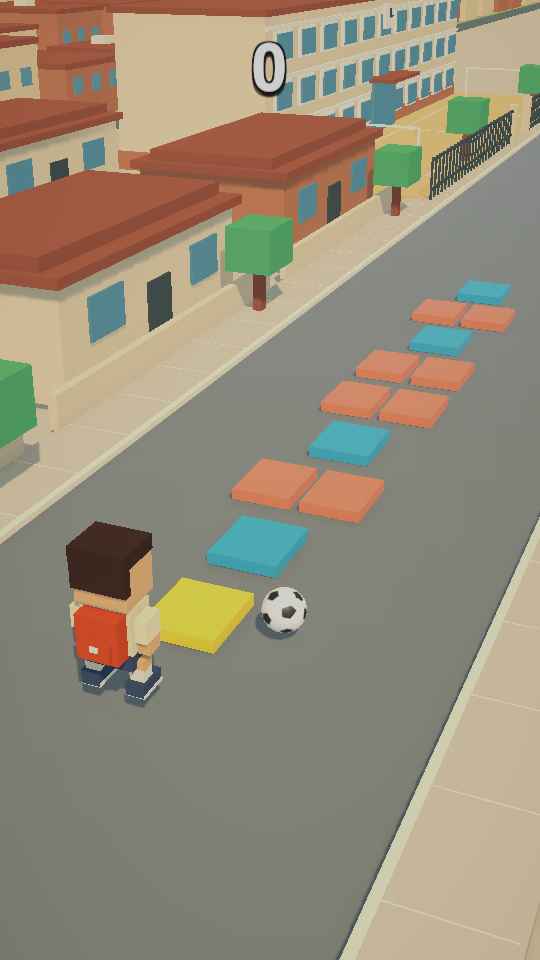
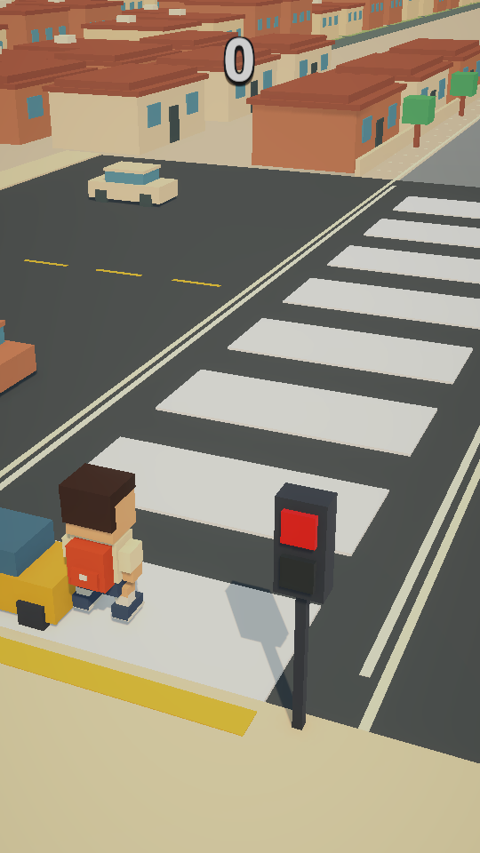

# Go To Home

어린 시절 귀갓길 놀이를 소재로 한 **Unity 세로 화면 3D 캐주얼 게임 프로토타입**입니다.
사방치기, 턱 걷기, 횡단보도를 짧은 구간으로 연결하고, 터치 한 종류에 서로 다른 판단을 담았습니다.

## 포트폴리오

- [장애물 플레이 영상 — 약 30초, MP4](https://github.com/foxra1n/go-to-home/releases/tag/portfolio-demo-2026-10-26)
- [개발 포트폴리오 PDF - 8쪽](docs/Go-To-Home_Unity_Portfolio.pdf)
- [개발 방식과 수정 기록](docs/DEVELOPMENT.md)
- [검증 결과 요약](docs/verification.json)

영상은 실제 PC 게임 화면과 소리를 녹화했습니다. 공 회피(0–11초), 바람 속 균형 유지(11–21초), 신호 대기와 횡단(21–27초), 빨간불 점프 실패(27–30초)를 담았습니다. 촬영 전용으로 장애물을 켜고 **1.4배속·자동 입력**으로 시연한 편집 영상이며, 일반 플레이의 정상 난이도 진행 설정은 변경하지 않았습니다. 비공개 저장소의 영상도 별도 열람 권한이 필요합니다.

이미지는 실제 PC 빌드의 진단 장면을 캡처한 정적 화면입니다. 게임은 개발 중이며 상용 출시 상태가 아닙니다.

## 역할 및 AI 활용

- **제작자 foxra1n:** 소재와 핵심 규칙, 비주얼 방향, 직접 플레이 테스트, 문제 재현과 개선 요구, 체감 결과 확인.
- **AI 개발 도구 지원:** C# 구현·수정, 구조 제안, 자동 테스트 작성·실행, PC 빌드, 문서 초안 작성.
- 전체 코드를 제작자가 단독으로 직접 작성한 프로젝트로 표기하지 않습니다. 이 저장소는 AI 지원을 활용한 개인 프로젝트의 현재 구현과 검증 기록입니다.
- 이전 제작 과정은 대화와 소스 수정으로 진행되었습니다. 이 저장소의 초기 업로드 커밋을 전체 개발 이력으로 보지 않으며, 과거 커밋을 임의로 만들어 넣지 않았습니다.

## 실행 환경

| 항목 | 버전 / 범위 |
|---|---|
| Unity | 6000.5.0f1 |
| 언어 | C# |
| 렌더링 | URP 17.5.0 |
| 입력 | Input System 1.19.0 |
| UI | uGUI 2.5.0 |
| 테스트 | Unity Test Framework 1.7.0 |
| 목표 플랫폼 | Android, 세로 화면 |
| 최근 검증 | Windows PC, PlayMode 52개 통과 |

1. 저장소를 내려받고 Unity Hub에서 루트 폴더를 추가합니다.
2. Unity **6000.5.0f1**로 열고 패키지 복원을 기다립니다.
3. `Assets/Scenes/SampleScene.unity`를 열고 **Play**를 누릅니다.
4. 터치, 마우스 왼쪽 버튼 또는 **Space**로 조작합니다.

캐릭터·타일·배경·UI는 `HopscotchPrototypeBootstrap`이 실행 시 생성합니다. 재생 전 Scene 창이 게임 화면과 다른 것은 이 구조 때문입니다. 기본 실행은 정상 세트 진행이며, `TestMaximumDifficulty` 강제 테스트 설정은 꺼져 있습니다.

## 플레이 규칙

| 구간 | 조작과 판정 |
|---|---|
| 사방치기 | 한 칸은 탭 1회, 두 칸은 탭 2회. 같은 패턴은 최대 2번 연속 등장. 일반 칸은 리듬 판정 유지. |
| 공 장애물 | 두 패턴 전 예고. 공 칸으로 한 번 즉시 점프하고, 착지 후 0.65초 안에 다시 탭해 다음 칸으로 탈출. 공은 왼쪽 밖까지 이동. |
| 턱 걷기 | 전진하며 기울어지는 방향을 탭으로 반전. 짧은 연타 제한과 바람의 시간별 영향 적용. |
| 횡단보도 | 흰색 위에 착지하도록 탭 점프. 공중 입력은 무시하고 예약하지 않음. 인도에서도 진입 점프 가능. 빨간불 점프는 차량 급정거 연출 후 실패. |

세 모드를 한 번씩 진행하면 1세트입니다. 순서는 무작위이며 세트 경계에서도 같은 모드가 연속하지 않게 처리합니다. 구간은 약 10초 분량을 생성하고, 구간 사이 준비 시간은 1.25초입니다.

| 세트 | 장애물 배정 대상 | 속도 |
|---|---|---|
| 1 | 없음 | 1.0배 |
| 2 | 랜덤 1구간 | 1.0배 |
| 3 | 랜덤 2구간 | 1.0배 |
| 4 | 3구간 모두 | 1.0배 |
| 5 | 3구간 모두 | 1.1배 |
| 6 | 3구간 모두 | 1.2배 |
| 7 | 3구간 모두 | 1.3배 |
| 8 이후 | 3구간 모두 | 최대 1.4배 |

**예외:** 횡단보도 신호 대기는 배정 여부와 별개로 **1.2배 이상** 조건도 만족해야 나타납니다. 따라서 초기 단계의 배정 개수와 실제 장애물 노출 개수는 다를 수 있습니다.

이동·점프·음악·비프음은 배율을 공유합니다. 음악 가속은 `AudioSource.pitch`를 사용하므로 음높이도 변합니다. 사방치기의 입력 유예와 공 반응 시간은 속도와 별도로 유지합니다.

## 코드 살펴보기

모든 경로의 기준은 `Assets/HopscotchPrototype`입니다.

| 역할 | 대표 코드 |
|---|---|
| 입력 통합 | [TapInputReader.cs](Assets/HopscotchPrototype/Runtime/Input/TapInputReader.cs) |
| 세션 상태 | [GameSessionController.cs](Assets/HopscotchPrototype/Runtime/Core/GameSessionController.cs) |
| 모드 인터페이스 | [IGameMode.cs](Assets/HopscotchPrototype/Runtime/Core/IGameMode.cs) |
| 구간 전환 | [GameModeSequenceController.cs](Assets/HopscotchPrototype/Runtime/Core/GameModeSequenceController.cs) |
| 세트 난이도 | [DifficultyController.cs](Assets/HopscotchPrototype/Runtime/Core/DifficultyController.cs) |
| DSP 박자·음악 | [RhythmClock.cs](Assets/HopscotchPrototype/Runtime/Core/RhythmClock.cs) |
| 사방치기 입력 판정 | [HopscotchTapJudge.cs](Assets/HopscotchPrototype/Runtime/Hopscotch/HopscotchTapJudge.cs) |
| 균형 시뮬레이션 | [CurbBalanceState.cs](Assets/HopscotchPrototype/Runtime/CurbBalance/CurbBalanceState.cs) |
| 횡단보도 상태·점프 | [CrosswalkModeController.cs](Assets/HopscotchPrototype/Runtime/Crosswalk/CrosswalkModeController.cs) |

## 테스트 및 빌드

Unity Test Runner에서 `Assets/HopscotchPrototype/Tests/PlayMode`와 `Tests/Editor`의 테스트를 실행할 수 있습니다.

최근 정상 진행 복구 버전의 **PlayMode 52 / 52 통과** 결과를 `docs/verification.json`에 정리했습니다. 원본 보고서의 로컬 PC 경로는 제외했습니다. 이 수치는 이번에 실행한 PlayMode 검사 결과이며, 전체 테스트 커버리지나 성능 보장을 뜻하지 않습니다.

Windows 빌드는 `Assets/Scenes/SampleScene.unity`를 포함하여 Build Profiles에서 생성할 수 있습니다. Android는 별도 빌드 지원 모듈이 필요합니다. 기존 PC 실행 파일이나 APK를 소스 저장소에 포함하지 않았으며, 최신 APK를 새로 제작한 것은 아닙니다.

## 현재 한계와 다음 과제

- 최신 Android 실기기 회귀 테스트 및 FPS·발열·메모리 측정
- 처음 접하는 사용자 대상 튜토리얼 및 조작 이해도 검증
- 일시정지·소리 설정, 장애물 노출 빈도 조정
- 제작자 중심 정성 피드백을 넘어선 사용자 테스트 기록

상점·광고·결제·로그인·온라인 기능은 현재 범위에 포함하지 않습니다.
비공개 저장소 링크를 채용 담당자에게 전달하려면 별도 열람 권한이 필요합니다. PDF 자체는 저장소 로그인 없이 읽을 수 있도록 독립적인 문서로 구성했습니다.
